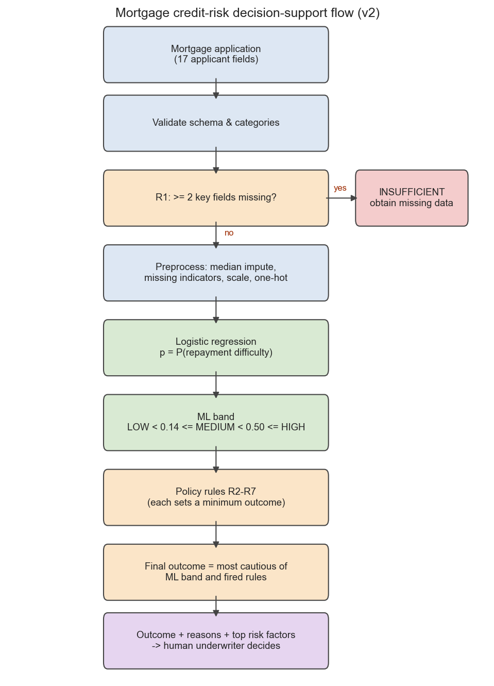

# Mortgage Credit-Risk Decision Support Prototype

Proof of concept AI/ML decision support system for a UK mortgage lender.
It predicts the probability of major repayment difficulty within 12 months and uses documented decision rules to offer an interpretable recommendation to a human reviewer.

> **It does not automatically approve/reject applications.** It suggests a risk level and the reasons, and a person makes the decision.

## What it does
1. Learns from 800 past mortgage applications which ones ran into repayment difficulty.
2. Gives each new application a risk score between 0 and 1.
3. Applies the lender's rules, for example "credit score below 550 means HIGH".
4. Returns a risk level, the reasons, and the 3 things that raised the risk most.

| Result | What it means | Suggested next step |
|---|---|---|
| LOW | Little sign of risk | Normal review |
| MEDIUM | Some warning signs | Closer review, ask for more evidence |
| HIGH | Strong warning signs | Pass to a senior underwriter |
| INSUFFICIENT | Important information is missing | Get the missing information first |



## How to install
You need Python 3.9 or newer.
```bash
git clone https://github.com/mariapricope/mortgage-credit-risk-dss.git
cd mortgage-credit-risk-dss
python3 -m venv .venv
source .venv/bin/activate
pip install -r requirements.txt
```
On Windows, use `.venv\Scripts\activate` instead of the `source` line.

## How to run
| Command | What it does |
|---|---|
| `python main.py` | Runs everything: studies the data, trains and tests both versions, and compares them |
| `python main.py score --input data/sample/new_applications.csv` | Rates the 5 example applications |
| `pytest` | Runs the 45 automatic checks |

Example result for one application:
```
NEW003: HIGH (risk score 0.97)
  High risk - refer to senior underwriter
  Reasons: ML risk score 0.97 -> HIGH band; Debt-to-income ratio above 0.50 (affordability stress); Previous default combined with recent missed payments
  Main risk factors: credit score, previous default, missed payments (24m)
```
Charts and result tables are saved in the `reports/` folder each time you run it.

## Results
Tested on 160 applications the system had not seen before, 35 of which had repayment difficulty:

| | Version 1 | Version 2 |
|---|---|---|
| Risky applicants caught | 13 of 35 | **27 of 35** |
| Safe applicants sent for an extra check | 12 of 125 | 52 of 125 |

Version 2 catches twice as many risky applicants. The cost is more extra checks on safe ones.

## Folders
| Folder | What's inside |
|---|---|
| `main.py` | Starts the program |
| `src/mortgage_dss/` | The code |
| `tests/` | The automatic checks |
| `data/` | The dataset and example applications |
| `docs/` | Design, rules, testing and improvement details |
| `reports/` | Charts and results (created when you run it) |

More detail: [system design](docs/design/system_design.md), [rules table](docs/design/decision_table.md), [testing and improvement](docs/testing_and_evaluation.md).

## Please note
The data is made up for learning purposes, and the rule limits are examples, not a real lender's policy.
